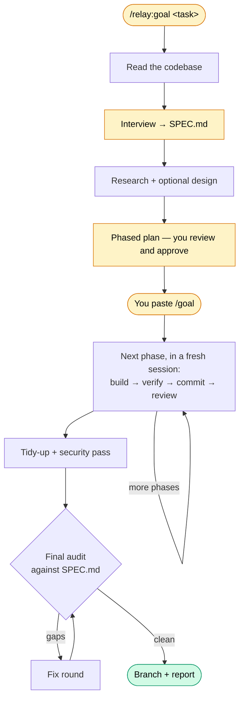

# Relay

[](https://github.com/mack5imal/relay/actions/workflows/ci.yml) [](https://github.com/mack5imal/relay/releases) [](LICENSE)

**Plan it with you, then build it without you.**\
Relay is a Claude Code plugin that turns even a vague product, feature or other build request into finished, tested and audited code: careful planning with you up front, then autonomous work you don't have to watch. Define the spec, paste the command, then walk away. You return to a finished product.

**Planning is a conversation.**\
Bring a new product idea to an empty folder and Relay checks the tools on your machine, sets up git, and works out the stack and the shape of a first version with you. Point it at existing code and it reads the code first, so it doesn't ask what the code already answers. Either way, it then interviews you about everything only you can tell it: what "done" means, what's out of scope, the unusual situations to handle, and what the build must never do. Your answers become a written spec with measurable success criteria. Relay researches the unknowns with sources, then proposes a phased plan for you to review, change and approve. For UI work, Relay includes an optional stage that provides everything you need to design the front end in Claude Design or another design tool. Your time and attention during the planning phase are well rewarded: settling what to build up front is what lets the build run on its own.

**The build runs unattended.**\
You paste one `/goal` line and walk away. Each phase is run by a subagent with its own dedicated context window, so a large build never runs out of context. Each phase verifies its own work and commits it to the run's own branch. Every phase also undergoes code review by a new subagent who didn't write the original, and failures are fixed on their own. When all phases are complete, Relay runs a code cleanup and a security review, and then fixes anything it finds. A final audit checks the result against the spec you agreed to, including the tests behind each success criterion. You come back to a branch of commits and a short report of anything Relay couldn't settle.

## What makes it different

- **Unattended means unattended.** Failures are retried, then handed to a fresh session with a fix plan. Nothing in the run waits on you; what needs a human look goes into the final report. A usage limit, a crash or a closed laptop costs at most the phase in progress.
- **It builds what you actually want.** A thorough interview runs after Relay reads your request and analyzes any pre-existing code, so it asks only what the code can't answer, and it keeps going until an ambiguity score says the spec is clear. Edge cases, gray areas, and prohibitions are raised explicitly, and the spec is the yardstick for the whole run.
- **Large builds finish.** A single session building phase after phase eventually runs out of context window. Relay orchestrates the build from one small session and gives every phase, fix and check a fresh session, so the size of the build stops being the limit.
- **The last phase gets the same care as the first.** A model's work gets worse as its context fills with old work, long before it runs out (often called context rot). Every Relay phase starts clean, with only what it needs: its part of the plan, a map of the code it touches, and notes from the phases it builds on. The coordinating session holds each phase's short report, not its work.
- **The builder doesn't grade its own work.** Separate reviewers check correctness after each phase, tidy up duplicated or dead code, and look for security gaps across phases. The final audit re-runs your build and tests, checks every success criterion, and reads the tests to confirm they test what you asked for. Its coverage line says honestly how much it could check.
- **Your decisions stay yours.** The checks never undo something you decided in planning. When a check overrides a guess Relay made itself, the final report says so.
- **Each phase knows the codebase.** With [graphify](https://github.com/Graphify-Labs/graphify) installed, every phase gets a map of the code it touches: where each symbol is defined, what it uses and what uses it. What earlier phases learned is handed to later ones as memory.
- **A clean git history.** One commit per verified phase, on a `relay/<run-id>` branch. Relay never pushes unless you turn pushing on, and it refuses to commit secrets or generated files.

## Requirements

**Required**

- [Claude Code](https://code.claude.com), a recent release (Relay hands off to its built-in [`/goal`](https://code.claude.com/docs/en/goal) command).
- `git`, `bash`, `python3` 3.8 or later, and `perl`. macOS and Linux include all of these.
- A git repository to work in. In a folder that isn't one, Relay offers to create it.

**Strongly recommended**

- **[graphify](https://github.com/Graphify-Labs/graphify)**, installed with [uv](https://docs.astral.sh/uv/). It builds a local code graph in a few seconds (no network, no AI), which is how each phase sees the code earlier phases wrote. Without it, phases fall back to matching file names. All of Relay's test builds so far ran with graphify installed.
- **Web search** enabled in Claude Code, and the **[Context7](https://github.com/upstash/context7)** MCP server for library docs. The research step uses them to answer questions with sources; without web search, research falls back to training knowledge and is marked unverified.

**Optional**

- The [GitHub CLI](https://cli.github.com) (`gh`), if you want Relay to create a private GitHub repository for a project that has none or push its own branch.
- Claude Design, or any design tool or designer, for the optional design stage.

### Platform support

- **macOS:** developed and tested here, including every full-length build.
- **Linux and WSL:** every change runs the full automated test suite on Linux, which stands in for WSL. It should work, but no one has run a full build on either by hand yet.
- **Windows (native):** not supported. Never tested, and not expected to work as is: Relay's helper scripts are bash and use Unix process tools. Use WSL.

## Install

Inside a Claude Code session:

```text
/plugin marketplace add https://github.com/mack5imal/relay.git
/plugin install relay@relay
/reload-plugins
```

Then install the recommended tools from a terminal:

```bash
brew install uv                  # Linux or WSL: curl -LsSf https://astral.sh/uv/install.sh | sh
uv tool install graphifyy        # graphify (the package name has two y's)
npx ctx7 setup --claude          # Context7; see its README for other options
```

`/relay:goal` is now available. If `/plugin install` says "not found", run `/plugin marketplace update relay` and try again.

> **Tip:** `/plugin marketplace add mack5imal/relay` works too. Claude Code tries SSH first and falls back to HTTPS; set `CLAUDE_CODE_PLUGIN_PREFER_HTTPS=1` to skip the SSH attempt. The HTTPS URL above never needs an SSH key.

## Quick start

Open Claude Code in your project and describe what you want:

```text
/relay:goal add a dark mode that follows the system setting, with a toggle in settings
```

1. **Plan with Relay.** Answer the interview questions, approve the research questions, and review the plan. Relay shows the success criteria the run will be graded against, the assumptions it made and the risks it sees, and lets you change any phase before you start.
2. **Paste one line.** Relay checks that your build and tests run, then prints a `/goal` line. Start a new Claude Code session in the same folder, switch it to auto mode, and paste the line. In the default mode, Claude Code asks before most edits and commands, and the run would wait at the first one.
3. **Walk away.** The run builds, checks and audits on its own. It ends with `RELAY_RUN_COMPLETE`: the branch, the audit result, anything left for you to look at, and the `git push` command when pushing is off.

Options, added after the task:

| Option | What it does |
|---|---|
| `--quick` | A shorter interview, for a project that is already well defined or a small task. |
| `--lean` | Turns off the per-phase code review, the tidy-up and the security pass for a faster, cheaper run. The final audit still runs. |
| `--design` | Includes the design stage even when the task doesn't look like UI work. |
| `--push` / `--no-push` | Push the run's branch after the audit, or don't. Off by default; `RELAY_PUSH=on` in your environment makes on your default. |

## Time and tokens

Because every phase starts in a fresh session and re-reads what it needs, runs can be token-heavy; however, most of the usage comes from cached reads.

Measured build sessions, planning not included, on Relay 0.10–0.11:

| What was built | Phases | Checks | Model and effort | Time | Tokens processed | Cached reads |
|---|---|---|---|---|---|---|
| Sorting options for an existing Python CLI | 2 | off (`--lean`) | Opus 5.5, high | 12 min | 8.0M | 95% |
| A file-output option for the same CLI | 3 | all on | Opus 5.5, high | 36 min | 21.7M | 96% |
| A new web app called Tunez from an empty folder, with the design stage | 19 | all on | Opus 5.5, high | 6 h 26 min | 270M | 98% |
| A large feature for Tunez, with 10 new screens (58 with their states) | 24 | all on | Opus 5.5, high | 12 h 55 min | 513M (plus 302M for audio-transcription work specific to that task) | 97% (whole run) |

The number of phases is a weak guide: the size of the codebase and what the task involves matter more, and retries and audit-fix rounds push usage up. Treat these as examples, not a forecast.

*None of these builds hit a usage limit on a Claude Max (5x) plan.* That said, a long run can reach your usage limit on a subscription plan; Claude Code waits for the reset and continues on its own as long as the session stays open and the limit resets within a day.

## How it works



Yellow steps involve you; everything after the paste runs on its own.

**Planning.** Relay reads your code and your saved Claude Code memories, then interviews you: five rounds every time (more until the spec is clear, fewer topics with `--quick`), plus a pass for edge cases and one for what the build must not do. The result is `SPEC.md`. For questions the spec leaves open, such as an unfamiliar library or a platform quirk, Relay proposes up to six research questions and, once you approve them, researches each in parallel with sources. Anything that contradicts the spec comes back to you. For UI work, Relay optionally writes a design brief for Claude Design and turns the design you hand back into checks the build must pass. It then splits the work into as many phases as the task needs, critiques its own plan, and shows you a summary to approve or change. Before printing the `/goal` line it runs your build and test commands once, and it refuses to start with uncommitted changes in the folder, since every phase commits.

**The build.** The `/goal` session only coordinates. For each phase it assembles a brief: the phase's spec, the success criteria, a map of the code involved, and what earlier phases learned. A fresh subagent builds the phase, proves each acceptance criterion with evidence on disk, and commits. A failure is retried once in the same session; a second failure gets a written fix plan and a new session; a third stops the run with a `/goal` line that resumes from the phases left. Interruptions are different: a phase cut short by a usage limit or a crash is simply re-run.

**The checks.** After each phase, a reviewer that didn't write it reads the diff for bugs and weak foundations, and one fix session addresses what it finds. After the last phase, a tidy-up pass removes duplicated and dead code in the files the run touched, and a security pass looks for gaps across phases when the build touches the network, auth, input, files, shell, secrets or new dependencies. None of these can stop the run: what can't be fixed goes into `FINDINGS.md`.

**The audit.** Finally, a fresh session re-runs your build and tests, checks every phase's acceptance criteria and every success criterion and prohibition in the spec, reads the tests behind each success criterion, and confirms every promised file exists and is used. Gaps get up to two fix rounds; if any remain after that, the run stops and lists them.

## If a run stops

Every finished phase is already committed, so a stop costs at most the phase in progress.

- **Usage limits and API errors.** Leave the session open. Claude Code waits for a limit that resets within a day and retries dropped connections; the interrupted phase resumes automatically.
- **A crash, a closed terminal or a restart.** Run `claude --resume` in the same folder, pick the run's session, and type `continue`. Relay works out whether the interrupted phase finished, is still running, or needs to run again.
- **A goal that doesn't come back.** `bash .relay/<run-id>/resume-line.sh .relay/<run-id>` prints a fresh `/goal` line.
- **A blocked action.** Auto mode occasionally refuses an action it judges risky. The run stops and explains; allow it or decide what to do, and it carries on.
- **A run that goes quiet.** Claude Code pauses idle check-ins after a while, so a stuck step can leave the run silent. Send any message; Relay checks the step and carries on.

## Git

- Started on your default branch, the run gets its own `relay/<run-id>` branch; started on any other branch, it commits there.
- One commit per verified phase, fix and check (`relay: phase 3 — <name>`), with trailers that tie each commit to its run and phase. A phase that fails commits nothing.
- Pushing is off by default. If push is turned on (`--push`), Relay pushes only a branch it created, once, after the audit: never `--force`, never your default branch. A failed push is reported, never a blocker.
- Secrets and generated files are refused, and a failing pre-commit hook is fixed, never bypassed.

## Good to know

- **Run files** live in `.relay/<run-id>/` in your project: the spec, the plan, live progress in `STATE.md`, per-phase evidence and logs, and `FINDINGS.md`. Git ignores the folder automatically.
- **Two builds at once in the same repo** need two `git worktree`s. Two planning sessions can share a folder; two builds would edit the same files.
- **Memory.** Each phase can save what a future run would want to know to Claude Code's memory folder for your repository, and later runs start with it.
- **Updating.** Run `/plugin marketplace update relay`, or turn on auto-update for the marketplace under `/plugin` → **Marketplaces**. To stay on one release, add the marketplace at its tag: `/plugin marketplace add https://github.com/mack5imal/relay.git#v1.0.0`.
- **Trying unreleased changes:** `git clone https://github.com/mack5imal/relay` and start Claude Code with `claude --plugin-dir <clone>`. Relay works only as a plugin: copied into `~/.claude/skills/`, it would register as a bare `/goal` and clash with the built-in command.

## Documentation

- [CHANGELOG.md](CHANGELOG.md): release notes. Current version: **v1.0.0**.
- [AGENTS.md](AGENTS.md): how the project is laid out and how to change it.
- [DESIGN.md](DESIGN.md): the architecture and the log of design decisions.

Contributions and bug reports are welcome in [issues](https://github.com/mack5imal/relay/issues).

## Credits

Relay is a fork of [Supergoal](https://github.com/robzilla1738/supergoal) v0.7.0 by Robert Courson (MIT). The planning stages, phase protocol, final audit and run namespacing are his work; Relay's changes are listed in [CHANGELOG.md](CHANGELOG.md) above the fork point.

The code-map retrieval approach (seed, expand, a confidence-tiered token budget) follows `bin/lib/graphify.cjs` from [get-shit-done](https://github.com/gsd-build/get-shit-done) v1.42.3 by Lex Christopherson (MIT), reimplemented rather than copied. The interview owes the same project two more ideas, also reimplemented: the weighted ambiguity model with per-dimension minimums (`workflows/spec-phase.md`) and the edge-case probe with its closed list of categories and dismissals that need a reason (`bin/lib/edge-probe.cjs`, `references/edge-probe.md`). Code graphs are built by [graphify](https://github.com/Graphify-Labs/graphify) (Apache-2.0).

## License

MIT. See [LICENSE](LICENSE).
