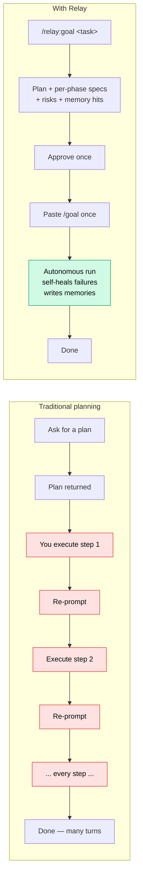

# Relay

Plan deeply, then autonomously build until it's done.

`/relay:goal <what you want>` recons your codebase, applies your saved preferences from memory, decomposes the work into the right number of phases for the task, gets one confirmation from you, then prints a **single ready-to-paste `/goal` command**. Paste it once and the rest is autonomous: every phase runs sequentially with built-in retry, fix-spec recovery, and per-phase memory writeback until `RELAY_RUN_COMPLETE`.

## How it works (at a glance)

```mermaid
flowchart TD
    Start(["/relay:goal &lt;your task&gt;"]) --> S0["Stage 0<br/>Load memory + detect tools"]
    S0 --> S1["Stage 1<br/>Restate + classify<br/>(asks only: install missing research tools?<br/>design stage? — ui only)"]
    S1 --> S2["Stage 2<br/>Recon (parallel)"]
    S2 --> S25["Stage 2.5 — Interview<br/>5 rounds: delta, core, boundaries,<br/>rejection, acceptance<br/>+ edge & prohibition probes"]
    S25 --> GATE{Ambiguity gate<br/>≤ 0.15, all minimums?}
    GATE -->|Not yet| S25
    GATE -->|Passed| SPEC["SPEC.md — what the<br/>audit will grade against"]
    SPEC --> S26["Stage 2.6 — Research<br/>you approve 1–6 questions →<br/>one researcher subagent each →<br/>sourced answers; contradictions to you"]
    S26 --> DQ{Design stage?<br/>--design or ui + yes}
    DQ -->|Yes| S27["Stage 2.7 — Design<br/>brief → you design in Claude Design<br/>(or any tool) → commit design/<br/>→ verify + fidelity criteria"]
    DQ -->|No| S3
    S27 --> S3["Stage 3<br/>Risks + dependencies<br/>(from the research digest)"]
    S3 --> S4["Stage 4<br/>Decompose into N phases<br/>(adaptive — no fixed count)"]
    S4 --> S5["Stage 5<br/>Write ROADMAP, STATE,<br/>phase-N.md specs to disk"]
    S5 --> S6{"Stage 6<br/>Self-critique +<br/>plan review +<br/>revision menu"}
    S6 -->|Revise| S4
    S6 -->|Start now| S65{"Stage 6.5<br/>Pre-flight<br/>smoke check"}
    S65 -->|Green| S7["Stage 7<br/>Print ready-to-paste /goal"]
    S65 -->|Red| S6
    S7 --> PASTE(["You paste /goal — once"])
    PASTE --> ORCH["Orchestrator, per phase:<br/>assemble brief → dispatch subagent<br/>→ echo its marker blocks verbatim"]
    ORCH --> LOOP["Subagent (own context window):<br/>read brief → do work →<br/>RELAY_PHASE_VERIFY<br/>(includes cleanliness grep) →<br/>commit the phase → write memory →<br/>RELAY_PHASE_DONE"]
    LOOP --> CHECK{Failure?}
    CHECK -->|None| NEXT{More phases?}
    NEXT -->|Yes| ORCH
    NEXT -->|No| AUDIT["FINAL AUDIT (own subagent per round)<br/>re-verify against ROADMAP <b>and SPEC.md</b><br/>re-run mandatory commands<br/>spot-check criteria<br/>+ check deliverables vs Baseline ref<br/>(full working tree)"]
    CHECK -->|1st| R1["Auto-retry in the<br/>same window, probe injected"]
    R1 --> LOOP
    CHECK -->|2nd| R2["Write fix-spec,<br/>fresh subagent executes it"]
    R2 --> LOOP
    CHECK -->|3rd| HANDOFF(["STOP — handoff with full probe<br/>history + a /goal line that<br/>resumes the remaining phases"])
    AUDIT --> AGAPS{Gaps?}
    AGAPS -->|None| DONE(["AUDIT_COMPLETE ✓<br/>+ coverage %<br/>push the run branch (if on)<br/>RELAY_RUN_COMPLETE ✓"])
    AGAPS -->|Round 1 or 2| AFIX["Write audit-fix-N.md,<br/>fresh subagent executes it"]
    AFIX --> AUDIT
    AGAPS -->|Round 3| AHO(["STOP — AUDIT_HANDOFF<br/>persistent gaps"])

    classDef human fill:#fef3c7,stroke:#d97706,color:#000
    classDef done fill:#d1fae5,stroke:#059669,color:#000
    classDef stop fill:#fee2e2,stroke:#dc2626,color:#000
    classDef audit fill:#dbeafe,stroke:#2563eb,color:#000
    class Start,PASTE,S25 human
    class DONE done
    class HANDOFF,AHO stop
    class AUDIT,AFIX audit
```



Yellow = the only steps you do — the interview, and one paste. Blue = the final audit that re-checks against your original plan. Green = success terminal (audit clean). Red = blocker handoff. Everything else is autonomous.

**Why subagents.** A single session executing every phase inline runs out of context on a large build — a 14-phase Swift app exhausted its window mid-run. In relay the `/goal` session is an orchestrator: each phase runs in its own subagent with a fresh context window, briefed from disk (its spec, the executor contract, memory written by earlier phases, a precomputed map of the symbols it touches, and the exact transcript block formats). The orchestrator's cost per phase is one compact report, so run length no longer depends on build size — only each phase has to fit one window, which the planner enforces at plan time with a files-touched estimate.

## How it's different



Two human touches total: one approval, one paste. The plan is **deeper** than a one-shot plan (recon, risk list, memory-informed phase shaping, validated specs) and the execution is **autonomous** instead of step-by-step babysitting.

## Why one `/goal` (not a chain)

Claude Code's `/goal` takes a short **end-state condition** that an evaluator checks against the transcript after each turn — not a long task body. Relay leverages this directly: one `/goal` covers the whole run; phase work lives in files the agent reads from disk. No char budget, no inter-session chain, no fragility.

Slash commands only fire from user input, so Stage 7 is an honest one-paste handoff: the planner prepares the `/goal` line, you paste it into a new Claude Code session in the same directory, the autonomous run starts. From there it drives itself to completion.

## Install — Claude Code

Three commands inside a Claude Code session:

```text
/plugin marketplace add https://github.com/mack5imal/relay.git
/plugin install relay@relay
/reload-plugins
```

That's it. `/relay:goal` is available immediately.

> **Tip:** the `owner/repo` shorthand (`/plugin marketplace add mack5imal/relay`) also works **only if you have GitHub SSH keys configured**, since it defaults to `git@github.com:` cloning. If you hit "SSH authentication failed" or "Permission denied (publickey)", use the HTTPS URL form above instead.

If `/plugin install` errors with "not found", run `/plugin marketplace update relay` and try again.

**From a clone** (skip the marketplace, or try unreleased changes):

```bash
git clone https://github.com/mack5imal/relay ~/relay
claude --plugin-dir ~/relay
```

`/relay:goal` is available in that session. Relay is plugin-only: copying `skills/goal/` into `~/.claude/skills/` is not supported — installed standalone, the skill would register as bare `/goal` and collide with the built-in command.

## Use

```text
/relay:goal build me an Expo app that converts photos to ASCII art
```

What happens:

1. **Stage 0 — Available context.** Detects your memory directory, preloads relevant feedback/user/project memories, senses which tools/MCPs are available this session.
2. **Stage 1 — Intake.** Restates the task, classifies it, and surfaces what it inherited from memory. No questions here — recon runs first.
3. **Stage 2 — Recon.** Parallel codebase/environment scan, plus a local code graph when graphify is installed (Stage 5 then gives every phase a `Map seeds:` line naming the symbols it touches).
4. **Stage 2.5 — Specification.** The interview, run *after* recon so it never asks what the repo can answer. Five rounds every time — current-state delta, irreducible core, explicit out-of-scope, what would make you reject it, and what "done" means — then more rounds until an ambiguity score clears its gate. Two completeness probes follow: an **edge probe** that raises only the edge cases that genuinely apply to each criterion's shape, and a prohibition pass for what the build must *not* silently become. Writes `SPEC.md`. `--quick` narrows it for tasks you already know are small.
5. **Stage 2.6 — Research.** The planner turns the spec's unknowns — risky algorithms, platform quirks, libraries it will lean on — into 1–6 specific questions (or a reasoned "none"). You approve or edit them, then one researcher subagent per question answers it with sources into `research/`. The planner reads only a digest of answers and implications, any finding that contradicts the spec comes back to you, and anything unverified is listed as an assumption. Without WebSearch, Stage 1 offers to stop so you can install it first.
6. **Stage 2.7 — Design (optional).** For UI work (`--design`, or a yes at Stage 1 when the task is tagged `ui`). Relay does not generate designs: it compiles a design brief from `SPEC.md` — screens, every state each must be drawn in, fixed copy, constraints — puts it on your clipboard for **Claude Design** (recommended; any design tool or designer works) with an overview of the four-stage design session, and stops. You put the export in the `design/` folder it created and say **design ready**; relay commits `design/` for you, and `check-design.sh` verifies the package and drafts structural fidelity criteria into `SPEC.md` (screens built, components present, tokens in one theme file, copy verbatim, plus a screenshot-or-reason capture you compare after the run — never a gate).
7. **Stage 3 — Deep think.** Identifies top-3 risks + dependencies, working from the research digest; anything still resting on training knowledge is written down as an assumption.
8. **Stage 4 — Decompose.** Phase count derived from the task — no fixed cap. Small change = 2 phases; full-stack greenfield = 8–12+.
9. **Stage 5 — Write specs.** `ROADMAP.md` + `STATE.md` + one `phase-N.md` work spec per phase, all under the run's namespaced `.relay/<run-id>/` dir.
10. **Stage 6 — Self-critique + plan review.** Before showing the summary, the planner runs **one** self-critique pass that flags vague criteria, mis-sliced phases, weak dependencies, and **any spec criterion no phase delivers** — rewriting falsifiability issues in place so the user sees the post-critique version. Then it shows the plan with the ambiguity scoreboard, **the success criteria your run will be graded against**, what ends the run, the phase-level criteria worth your eye (the full list is in `RUBRIC.md`), the scope it decided without asking you, assumptions, risks, applied memories, and a concrete revision menu: **Start now / Adjust assumption / Tweak a phase / Restructure phases.**
11. **Stage 6.5 — Pre-flight smoke check.** Before the `/goal` line is printed, the planner runs the deduplicated mandatory commands once. `PREFLIGHT_GREEN` → proceed to Stage 7. `PREFLIGHT_RED` → re-show Stage 6 with a "Skip pre-flight, dispatch anyway" option (for cases where the baseline being broken is exactly what phase 1 will fix). Catches "we'd thrash 3-strike loops against a broken baseline" before it happens. It also refuses a **dirty working tree** — any uncommitted change, tracked or untracked — because relay commits each phase and phase 1's commit would otherwise take your work with it. Commit or stash it (`! git stash -u`) and re-check; relay never stashes or discards your work for you.
12. **Stage 7 — Hand off.** If you are on the default branch, switches to a new `relay/<run-id>` branch (on any other branch it stays put); then captures `Baseline ref:` (the current `HEAD` sha) and `Memory dir:` into `STATE.md`, copies the orchestrator manual, the subagent brief template, and the helper scripts into the run dir, and prints a ready-to-paste `/goal` line. You paste it once, into a new session started in the same directory, so the run's window and transcript hold only the run. The `/goal` session becomes an **orchestrator**: for each phase it runs `assemble-brief.sh` (spec + contract + carryover memory + map slice + block formats → `phases/phase-N.brief.md`), dispatches a subagent with its own context window to execute the brief, echoes the subagent's marker blocks verbatim into the transcript when its report comes back, and records the report in `STATE.md` with `record-phase.sh`. 3-strike recovery is hybrid — auto-retry inside the phase's window, then a fix spec executed by a fresh subagent, then handoff — and every phase writes a memory at its boundary, which the orchestrator feeds into later phases' briefs so a cold window inherits what earlier ones learned. Each phase records its proof in `phases/phase-N.evidence.md` and its command output in `logs/`, so the transcript carries only compact marker blocks. Each `RELAY_PHASE_VERIFY` also includes a **cleanliness pass** — grep-based counts for debug prints, session TODOs, and dead imports added across this phase's **complete working-tree changes** (committed + staged + unstaged + untracked, via `repo-state.sh`), so uncommitted debug output is caught too (non-zero counts triggering 3-strike unless the spec sets `Cleanliness override:`).
13. **Final audit (after the last phase, before `RELAY_RUN_COMPLETE`).** Re-reads the original ROADMAP **and `SPEC.md`, so the run is checked against what you asked for and not only against the plan compiled from it**, re-runs the deduplicated mandatory commands (build / typecheck / lint / tests) once at the end to catch cross-phase regressions a per-phase VERIFY can miss, spot-checks every acceptance criterion, re-verifies every spec success criterion and prohibition — **reading the tests behind each of your success criteria to confirm they check what you agreed** (the same thresholds and situations, actually run, an expected answer the test works out itself; a test that doesn't is a gap the fix loop strengthens) — and **checks every declared deliverable against `Baseline ref` across the complete working tree** (committed, staged, unstaged, deleted, and untracked — not just commits) so an "agent said done but didn't ship" case becomes a gap even when the run never committed. Each round runs in its own subagent; on gaps it writes `audit-fix-<round>.md`, which a fresh subagent executes; up to 3 audit rounds before stopping. Only after `AUDIT_COMPLETE` does it print `RELAY_RUN_COMPLETE` — with an honest **audit coverage** line that says how many checks inspected tests and how many only confirmed a file exists. If more than 30% of checks were `trust-prior-verify` (subjective UI/UX criteria the audit can't re-run), `RELAY_RUN_COMPLETE` prepends a warning banner asking the user to eyeball before merging.

## Review, tidy-up and security checks

Passing its own criteria is not the whole bar: the code should also be well-formed and maintainable. Three checks run around the build, each in its own subagent, and **none of them can stop the run**:

- **A correctness review after each phase.** A reviewer that did not write the phase reads its diff for bugs, unsafe patterns, and abstractions later phases would build on badly. It changes nothing itself; its findings go to one fix window, gated by the phase's own acceptance criteria. The planner can skip a review for a docs- or config-only phase, and must say why (`Review: skip — docs only`). Stage 6 shows every skip.
- **A tidy-up pass after the last phase.** Removes what isolated phase windows leave behind — a helper re-invented three phases later, the same job done two ways, dead code — in the files this run touched only, without changing behaviour. It runs before the audit, so the audit re-verifies the code as it ships. Anything it can't safely fix is deferred with a reason.
- **A security pass before the audit**, when the build touches network, auth, user input, file paths, shell, secrets or new dependencies. It checks for gaps that only show across phases, such as a route a later phase added without the auth check the others have.

A finding that can't be fixed is undone and written to `FINDINGS.md` in the run dir, and `RELAY_RUN_COMPLETE` opens with a `⚠` line pointing at it.

The checks also hold their fixes against the plan you approved. A fix that would go against something **you** decided (your answers in the interview, the success criteria, the prohibitions) is never made: it goes to `FINDINGS.md` for you to decide. A fix that changes something **relay** decided on its own (the plan summary's "Scope I decided" lines and key assumptions) is made, because those were guesses, and `RELAY_RUN_COMPLETE` says so with a `⚠ Plan changed:` line.

**`--lean`** turns all three off for a faster, cheaper run (`/relay:goal <task> --lean`). The audit still checks every criterion. If the build touches a security surface, Stage 6 says so and you can switch the security pass (or any other check) back on before pasting `/goal`. It combines freely with `--quick`, which shortens the interview.

## Git: commits and the push

- **One commit per verified unit.** Each phase commits its own work as the last step of a passing verify (`relay: phase 3 — <name>`, with `Relay-Run:` / `Relay-Phase:` trailers); a fix window commits on success (`… (fix)`), as do a review fix (`… (review fix)`), the tidy-up (`relay: cleanup`) and a security fix (`relay: security fix`), and each audit-fix round commits once. A phase that fails commits nothing. The sha lands in the phase's row in `STATE.md`, so each phase's diff is one `git diff` away.
- **Where.** Started on your default branch → the run gets its own `relay/<run-id>` branch. Started on any other branch → commits land there.
- **Pushing is off unless you turn it on.** By default the run branch stays local, and `RELAY_RUN_COMPLETE` gives you the `git push` command to run once you've looked at it. Turn it on for one run with `--push` (`/relay:goal <task> --push`), or for every run with `RELAY_PUSH=on` in your environment (`--no-push` overrides that for one run). The plan summary shows the choice and you can change it there. On, relay pushes only a branch it created, once, after the final audit passes — `git push -u`, never `--force`, never your default branch, never a branch you were already on — and pre-flight warns if the remote looks unreachable. **A failed push never stops the run:** `RELAY_RUN_COMPLETE` reports it with the exact command to run yourself.
- **Guard rails.** The commit helper refuses secrets and generated files that aren't ignored (`.env`, `node_modules/`, `.venv/`, `__pycache__/`, …) — the phase adds them to `.gitignore` and commits again. A failing pre-commit hook is a phase failure the phase fixes, never bypassed. A run that hands off leaves the blocked phase's partial work uncommitted for you, and the resume line says so.

## Self-healing failure recovery

Built into every run:

- **First failure** of any acceptance criterion → `FAILURE_PROBE`, probe injected as feedback, **auto-retry once** in the same subagent window.
- **Second failure** → `FAILURE_ESCALATE`; the phase subagent writes a focused fix spec at `phase-N.fix.md` and returns; the orchestrator dispatches it to a **fresh** subagent.
- **Third failure** (the fix window fails too) → `FAILURE_HANDOFF`, state `BLOCKED`, stop. You take the wheel.

Flaky envs, typos, and missed deps self-resolve. Only real blockers escalate.

A handoff makes this run's `/goal` end-state permanently unsatisfiable, so the run stops for good — but it doesn't throw away the phases that finished. The orchestrator prints a ready-to-paste `/goal` (from `resume-line.sh`) scoped to the phases that remain: fix what blocked it, paste, and the run picks up where it stopped.

### If the run stops

A stop from outside the run is not a failure, and losing it costs at most the phase in flight — every finished phase is already committed.

- **Usage limits and API errors.** Run in auto mode and leave the session open: after a usage limit that resets within a day, Claude Code waits and continues on its own; overloaded servers and dropped connections are retried. A subagent cut short by one of these is re-run, never counted as a failure.
- **A crash, a closed terminal, a restart, a weekly limit.** Reopen the run's conversation — `claude --resume` in the same directory, pick the run's session — and type `continue`. The goal comes back, and `recover.sh` settles the phase that was running: it is re-run, and the new window keeps and reviews what the cut-short one left instead of starting over. A window that had finished before the stop is recorded, not re-run, and one that is in fact still running is left alone.
- **If the goal does not come back**, `bash .relay/<run-id>/resume-line.sh .relay/<run-id>` prints a fresh `/goal` line to paste.
- **If the run goes quiet.** After a while with nothing new, Claude Code pauses its idle check-ins, and only a finishing subagent wakes the run. A subagent that hangs would leave it silent. Send any message — `continue` is enough — and relay checks whether the step in progress is still running, then carries on or re-runs it.

## Memory writeback

Each phase ends with a "non-obvious learnings" check. If anything a future run on a similar task would benefit from was learned (an API quirk, a confirmed user preference, a project-level fact, a failure-and-fix pattern), it's saved to your memory directory using the standard `name`/`description`/`metadata.type` frontmatter. The final phase always writes a `project_<slug>.md` memory pointing at the new/changed project.

The memory directory is the one Claude Code keeps for your repository, shared by its worktrees and subdirectories — `~/.claude/projects/<main checkout path, non-alphanumerics → ->/memory` — with `$HOME/.claude/memory`, `$PWD/.claude/memory`, and `<run-root>/memory` as fallbacks; the detected path is recorded in `STATE.md` as `Memory dir:`. Memories written during a run are also fed into every later phase's brief (`STATE.md`'s `## Carryover`), so a phase running in a fresh window inherits what earlier phases learned. The skill works with or without a memory directory; it just starts smarter when one is present.

## Artifacts a run produces

Each run gets its **own** namespaced subdirectory under `.relay/` (e.g. `.relay/add-dark-mode-Ab3Kx9/`), claimed atomically at start, so two runs in the same working tree never overwrite each other:

```
.relay/
└── <task-slug>-<id>/         one isolated dir per run
    ├── SPEC.md               the agreed statement of intent (what the audit grades against)
    ├── ROADMAP.md            full plan
    ├── STATE.md              live progress (Run root, Baseline ref, Cleanup, Security pass, Memory dir, Carryover), updated per phase
    ├── FINDINGS.md           deferred / unresolved findings from the review, tidy-up and security checks (only when there are any)
    ├── THINKING.md           risks, dependencies, applied memories, best practices
    ├── PROTOCOL.md           the orchestrator's manual (copied at dispatch)
    ├── PHASE-BRIEF.md        the subagent contract template (copied at dispatch)
    ├── MARKERS.md            exact transcript block formats (copied at dispatch)
    ├── assemble-brief.sh     expands PHASE-BRIEF.md into each phase's brief (copied at dispatch)
    ├── record-phase.sh       records each subagent report in STATE.md (copied at dispatch)
    ├── resume-line.sh        prints the /goal that resumes a blocked run (copied at dispatch)
    ├── relay-git.sh          per-phase commits + the post-audit push, if on (copied at dispatch)
    ├── repo-state.sh         complete working-tree-vs-baseline helper (copied at dispatch)
    ├── run-logged.sh         runs commands with full output to logs/ (copied at dispatch)
    ├── logs/                 full command output, one log per command run
    ├── build-graph.sh        refreshes the code graph (copied at dispatch)
    ├── map-slice.sh, .py     map slices of named symbols (copied at dispatch)
    ├── graph/                code graph (graph.json + cache), when graphify is installed
    ├── context.md            recon output
    ├── repo-map.md           brownfield only
    ├── applied-memories.md   memory hits that informed the plan
    ├── tools.md              detected MCPs / skills / hosts
    └── phases/
        ├── phase-1.md
        ├── phase-1.brief.md      what the phase-1 subagent read (spec + contract + carryover + map slice)
        ├── phase-1.evidence.md   proof for every criterion, command, and diff
        ├── phase-1.review.evidence.md   the correctness review of phase 1 (when it ran)
        ├── cleanup.evidence.md, security.evidence.md   the tidy-up and security pass
        ├── phase-2.md
        ├── ...
        └── phase-N.md
```

Two `/relay:goal` **planning** sessions can safely share a working tree — their artifacts are isolated. Running two `/goal` **executions** in the same tree is still unsafe (they edit the same source files), so use a separate `git worktree` per task for true parallel builds.

## Skill internals

```
skills/goal/
├── SKILL.md
├── references/
│   ├── planning-depth.md          what makes a plan deep enough to hand off
│   ├── phase-design.md            how to slice phases (adaptive count, no cap)
│   ├── goal-format.md             /goal mechanics; who prints the transcript blocks
│   ├── research.md                Stage 2.6: plan-time research — why here, good questions, the contract
│   ├── design-stage.md            Stage 2.7: the design package contract and fidelity criteria
│   └── repo-state-comparison.md   the one comparison strategy (working tree vs baseline)
├── scripts/
│   ├── claim-run.sh           atomically claims a unique per-run dir (concurrent-run isolation)
│   ├── edge-probe.py          raises only the edge cases that apply to each criterion's shape
│   ├── validate-spec.sh       the spec content gate (measurable criteria, reasoned dismissals)
│   ├── resume-line.sh         the /goal line that resumes a blocked run
│   ├── relay-git.sh           pre-flight tree check, run branch, per-phase commits, post-audit push (opt-in)
│   ├── detect-env.sh          greenfield env recon
│   ├── detect-stack.sh        brownfield stack recon
│   ├── summarize-repo.sh      repo map
│   ├── repo-state.sh          complete working-tree-vs-baseline comparison (audit + cleanliness)
│   ├── run-logged.sh          runs a command with full output to a log, prints exit + short tail
│   ├── build-graph.sh         builds/refreshes the run's code graph with graphify (optional)
│   ├── map-slice.sh           map slice of named symbols, with a file-name fallback
│   ├── map-slice.py           the slicer: exact seeds, one hop, token budget (stdlib Python)
│   ├── check-seeds.sh         checks each phase's map seeds will exist when the phase runs
│   ├── check-research.sh      validates the research answers; --digest prints what the planner reads
│   ├── check-design.sh        verifies the design package, drafts fidelity criteria, --verify checks the build
│   ├── assemble-brief.sh      builds each subagent's brief from the template + run state
│   ├── record-phase.sh        validates a subagent's report and records it in STATE.md
│   └── validate-phase.sh      checks phase spec structure (+ sizing and exemplar warnings)
└── templates/
    ├── SPEC.md
    ├── RESEARCH-BRIEF.md      the Stage 2.6 researcher brief (one question, answer format)
    ├── DESIGN-BRIEF.md        the Stage 2.7 brief for Claude Design (or any design tool)
    ├── ROADMAP.md
    ├── STATE.md
    ├── phase-goal.txt         phase spec skeleton
    ├── PROTOCOL.md            the orchestrator's manual
    ├── PHASE-BRIEF.md         the subagent contract (mode-fenced: phase / fix / audit / audit-fix)
    └── MARKERS.md             exact transcript block formats
```

## Requirements

- **Claude Code**: `/goal` is a built-in command (no extra plugin). Available in current Claude Code releases. See [code.claude.com/docs/en/goal](https://code.claude.com/docs/en/goal).

Relay runs on Claude Code only, on macOS, Linux and Windows under WSL; every push is tested on macOS and Linux. Native Windows is untested. It needs `bash`, `git`, `python3` 3.8+ and `perl`, which all three come with. Run it in a git repository; in a folder that isn't one, relay offers to create it (and, when you turn pushing on with no remote, to create a private GitHub repository through the `gh` CLI).

**Token usage — measured, not estimated.** Runs are token-heavy because every phase starts in a fresh context window. Three measured runs on a small Python CLI used 8.0M tokens processed (2 phases, checks off), 21.7M (3 phases, all checks on) and 23.9M (7 phases), mostly cached re-reads. Retries, audit-fix rounds and a larger codebase all push usage up, so treat these as examples, not a forecast. On a subscription plan a long run can reach your usage limit; Claude Code waits for the reset and continues on its own as long as the session stays open and the limit resets within a day.

**Optional — code maps:** `brew install uv && uv tool install graphifyy` (on Linux or WSL, install uv with `curl -LsSf https://astral.sh/uv/install.sh | sh`) installs [graphify](https://github.com/Graphify-Labs/graphify). With it, relay builds a local tree-sitter code graph (no LLM, no network, a few seconds) and gives each phase a compact map of the symbols it touches — declaring files, members, what they use, what uses them, with line numbers. Without it, phases get file-name matches instead; nothing else changes.

## Version

Current: **v0.11.0**. See [CHANGELOG.md](CHANGELOG.md) for release notes.

Marketplace consumers can pin a specific version via the `/plugin` UI. Auto-updates are off by default for third-party marketplaces — enable per-marketplace via `/plugin` → **Marketplaces** if you want them.

## Credits

Relay is a fork of [Supergoal](https://github.com/robzilla1738/supergoal) v0.7.0 by Robert Courson (MIT). The planning stages, phase protocol, final audit, and run namespacing are his work; relay's changes are listed in [CHANGELOG.md](CHANGELOG.md) above the fork point.

The map-slice retrieval approach (seed, expand, confidence-tiered token budget) follows `bin/lib/graphify.cjs` from [get-shit-done](https://github.com/gsd-build/get-shit-done) v1.42.3 by Lex Christopherson (MIT), reimplemented rather than copied. Stage 2.5 owes the same project two more ideas, also reimplemented: the weighted **ambiguity model** with per-dimension minimums (`workflows/spec-phase.md`) and the **edge-completeness probe** — a closed taxonomy, a relevance filter, and dismissals that require a reason (`bin/lib/edge-probe.cjs`, `references/edge-probe.md`). Code graphs are built by [graphify](https://github.com/Graphify-Labs/graphify) (Apache-2.0).

## License

MIT. See [LICENSE](LICENSE).
